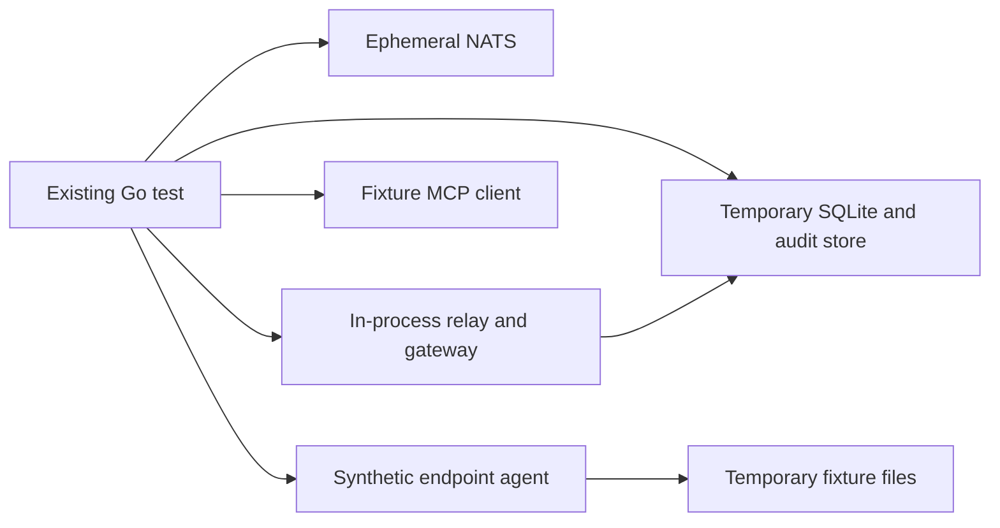

# Portable-demo architecture

The repository's production-oriented components remain visible in source, but the portfolio command starts only local test fixtures. It does not exercise operating-system service installation, a deployed relay, an external identity provider, or a managed endpoint.

The fixture follows the same package seams as the historical implementation: policy receives a request, the gateway and relay route it, the synthetic agent applies read/change constraints, and the audit store records and verifies the outcome. The tests use generated fixture identities and temporary paths; they are not evidence about an external tenant or a Windows service.

## Scenario-to-source map

| Scenario | Existing source case |
| --- | --- |
| Tenant/grant isolation, permitted/denied reads, access end, audit verification | `e2e.TestCrossTenantGate` |
| Reviewed change, rollback, stale-plan rejection, lock | `e2e.TestTechnicianApprovalE2E` |
| Audit export and deliberate tamper detection | `internal/relay.TestAuditExportAndVerify` |
| Device revocation disconnect and reconnect refusal | `internal/relay.TestRevokeDeviceCutsItOff` |

The wrapper runs these aggregate cases exactly as existing tests. Each has several assertions, so the terminal headings are a map to test coverage rather than a claim of seven separately implemented test programs.

## Operational boundary

In the full architecture, endpoint management and relay operation are separate concerns with their own environment, credentials, authorization, and rollback procedures. They were removed from this package to avoid presenting a local synthetic test as an installation recipe or live validation.
